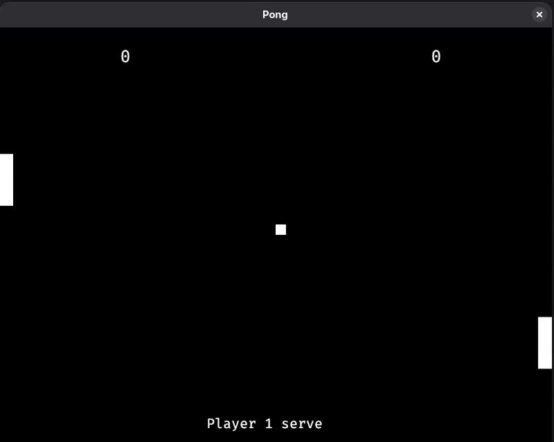
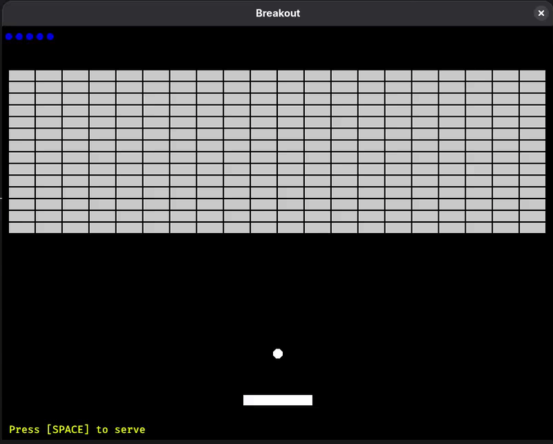

# Ignis

[Japanese (日本語版)](./README.ja-JP.md)

## Overview
This project is a personal attempt at building a 2D game framework in C, using Vulkan as the backend renderer, with the API inspired by [Raylib](https://www.raylib.com/).

## Features
1. 2D Batch Renderer
   - Batches sprites and shapes to reduce draw calls.
   - Uses a depth buffer so sprites and shapes can be drawn at specific depths/layers.
2. Raylib-Inspired Drawing Loop
   - Simple immediate-mode frame flow (`BeginDrawing`, `Draw...`, `EndDrawing`).
   - Supports framerate capping.
   - Tracks delta time and total elapsed time per frame.
3. Shape and Curve Rendering
   - Draws filled and outlined rectangles with custom size, color, and origin pivot points.
   - Draws circles and lines with adjustable thickness.
   - Computes and draws Bézier curves using precomputed Pascal's triangle coefficients.
   - Calculates tangents along Bézier curves for orientation and path following.
4. Textures and Text
   - Loads PNG, JPG, and BMP images, and uploads them to Vulkan textures.
   - Loads TTF font files and bakes character glyphs into a runtime texture atlas.
   - Functions to measure text dimensions for alignment and UI layout.
5. 2D Math and Collision Detection
   - Vector2 math operations (add, subtract, scale, dot product, normalize, distance, project, reflect).
   - Collision checks between Rectangles (AABB vs AABB), Circles (Circle vs Circle), and Circle vs Rectangle.
6. Input and Utilities
   - Keyboard and mouse polling (`IsKeyPressed`, `IsKeyDown`, `IsKeyReleased`, `IsKeyUp`).
   - Mouse cursor position queries.
   - Random integer and float generation with custom seed support.

## Sample Games
The `sandbox/` directory contains two playable arcade games built with the library:
- Pong ([sandbox/pong.c](./sandbox/pong.c))<br/>
  Classic 2-player game with paddle movement, ball bounce physics, and score tracking.
  
- Breakout ([sandbox/breakout.c](./sandbox/breakout.c))<br/>
  Brick-breaking game featuring paddle controls, ball deflection off rectangular bricks, lives, and restart handling.
  

## Tech Stack & Dependencies
- **Language**: C11
- **Graphics API**: Vulkan
- **Windowing & Input**: [GLFW](https://www.glfw.org/) 3.3.8 (included in `src/deps`)
- **Image Loading**: [stb_image](https://github.com/nothings/stb)
- **Font Rendering**: [stb_truetype](https://github.com/nothings/stb)
- **Shader Compiler**: [glslangValidator](https://github.com/KhronosGroup/glslang) (GLSL to SPIR-V)
- **Build System**: CMake (3.10+)

## Project Structure

```text
|-- include/
|   |-- ignis/
|   |   |-- ignis.h              # Public library API (window, input, shapes, text, textures)
|   |   |-- ignis_bezier.h       # Bézier curve math and tangent calculations
|   |   |-- ignis_math.h         # Vector2 math, collision checks, and helpers
|-- src/
|   |-- deps/
|   |   |-- glfw-3.3.8/          # Bundled GLFW source library
|   |-- dynamic_array.c          # Simple dynamic array implementation
|   |-- dynamic_array.h          # Dynamic array header
|   |-- ignis.c                  # Core engine lifecycle, input handling, and font atlas
|   |-- ignis_bezier.c           # Bézier curve implementation using Pascal's triangle
|   |-- ignis_bezier_internal.h  # Internal Bézier functions
|   |-- ignis_graphics.c         # Vulkan 2D batch renderer and pipeline setup
|   |-- ignis_graphics.h         # Graphics subsystem header
|   |-- ignis_math.c             # Vector operations and collision detection
|   |-- ignis_vulkan.c           # Vulkan buffer, image, and view helper functions
|   |-- ignis_vulkan.h           # Vulkan helpers header
|   |-- stb_image.h              # Image file loader
|   |-- stb_truetype.h           # TrueType font loader and rasterizer
|   |-- CMakeLists.txt           # Library build configuration
|-- sandbox/
|   |-- resources/
|   |   |-- fonts/               # TrueType font file (FiraMono-Regular.ttf)
|   |   |-- shaders/             # Vertex and fragment GLSL shaders
|   |-- breakout.c               # Breakout sample game
|   |-- CMakeLists.txt           # Sandbox build configuration
|   |-- pong.c                   # Pong sample game
|-- build.bat                    # Windows build script
|-- build.sh                     # Linux build script
|-- CMakeLists.txt               # Main CMake build configuration
```

## Building and Running

### Prerequisites
- CMake 3.10 or higher
- C11 compliant compiler (GCC, Clang, or MSVC)
- Vulkan SDK (headers, loader, and `glslangValidator`)
- On Linux (Fedora):
  ```bash
  sudo dnf install cmake clang glslang vulkan-headers vulkan-loader-devel vulkan-validation-layers-devel vulkan-tools libX11-devel libXrandr-devel libXinerama-devel libXcursor-devel libXi-devel
  ```
- On Linux (Ubuntu / Debian):
  ```bash
  sudo apt install cmake clang glslang-tools libvulkan-dev vulkan-validationlayers-dev libx11-dev libxrandr-dev libxinerama-dev libxcursor-dev libxi-dev
  ```

### Build Instructions

#### On Linux / macOS / WSL:
```bash
./build.sh
cd build/sandbox
./pong
# or
./breakout
```

#### On Windows (CMake & Visual Studio / MinGW):
```bat
build.bat
cd build\sandbox
pong.exe
# or
breakout.exe
```
